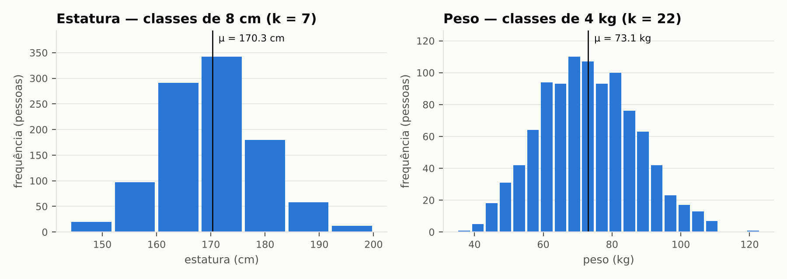
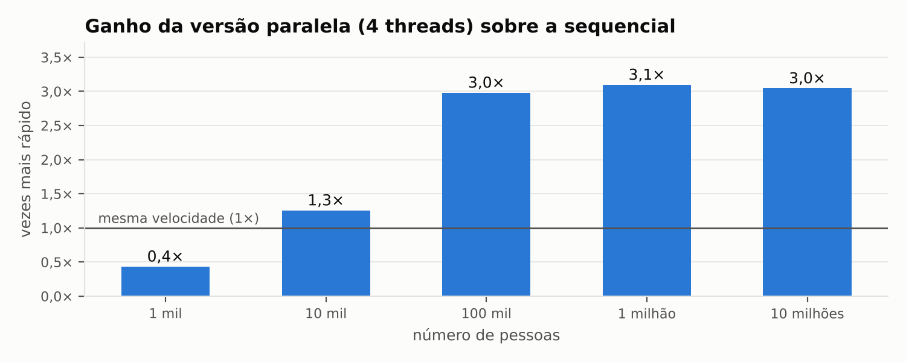

# 1. O que o programa faz

O programa, escrito em C++ (`src/cv_openmp.cpp`), lê um arquivo com a estatura e o peso de
1000 pessoas e agrupa os valores em faixas (classes): 8 cm para a estatura e 4 kg para o peso.
Com essas classes, calcula a média, o desvio padrão e o **coeficiente de variação (CV)** de
cada variável, usando as fórmulas do enunciado para dados agrupados.

O enunciado não trouxe o arquivo de dados. Por isso, usei 1000 pessoas geradas por computador,
com valores realistas (`dados/pessoas_1000.txt`). O programa aceita qualquer outro arquivo no
mesmo formato.

Para medir o ganho do paralelismo, o programa tem duas versões do cálculo: uma
**sequencial**, que usa um núcleo do processador, e uma **paralela**, que usa vários núcleos
com OpenMP. As duas rodam sobre os mesmos dados.

# 2. Resultados

| Variável | Média | Desvio padrão | Coeficiente de variação |
|---|--:|--:|--:|
| Estatura | 170,30 cm | 9,24 cm | **5,43 %** |
| Peso | 73,06 kg | 13,99 kg | **19,16 %** |

O CV mede o quanto os valores variam em relação à média. Como é dado em porcentagem, ele
permite comparar variáveis com unidades diferentes, como cm e kg. A **estatura varia pouco
(5,43 %)**: as pessoas têm alturas parecidas. O **peso varia bem mais (19,16 %)**, cerca de 3,5
vezes mais que a estatura. Isso é esperado, porque o peso depende da altura e também do
tipo físico de cada pessoa.

As versões sequencial e paralela chegaram exatamente aos mesmos valores. Um segundo cálculo,
feito à parte em Python (`scripts/verificar.py`), confirmou os resultados.

# 3. O que foi paralelizado e por quê

O cálculo de cada variável tem quatro passos, e todos foram paralelizados com OpenMP. Os dois
primeiros passos percorrem as 1000 pessoas. Os dois últimos percorrem só as classes: 7 de
estatura e 22 de peso.

| Passo | O que faz | Diretiva OpenMP |
|:-:|:--------------------------|:-----------------------|
| 1 | encontra o menor e o maior valor, para montar as classes | `parallel for reduction(min, max)` |
| 2 | conta quantas pessoas caem em cada classe | `parallel for reduction(+ : f[:k])` |
| 3 | faz as somas da média | `parallel for reduction(+)` |
| 4 | faz a soma do desvio padrão | `parallel for reduction(+)` |

A diretiva `parallel for` divide as repetições de um laço entre os núcleos do processador.
Mas todos os passos acumulam um resultado numa mesma variável: uma soma, um contador, um
mínimo ou um máximo. Se várias threads mexessem nessa variável ao mesmo tempo, algumas
atualizações se perderiam e o resultado sairia errado. Esse problema se chama **condição de
corrida**.

A cláusula **`reduction`** resolve o problema: cada thread faz a sua parte da conta
separadamente e, no final, o OpenMP junta os resultados parciais. Essa solução é mais rápida
que bloquear a variável a cada atualização, que é o que fazem `critical` e `atomic`.

A leitura do arquivo não foi paralelizada. Ela acontece uma única vez e depende do disco.

# 4. Comparação de desempenho

Medi as duas versões num computador com 4 núcleos. Cada uma foi executada milhares de vezes, e
usei o tempo típico de cada uma (a mediana).

**Com as 1000 pessoas do exercício, a versão paralela foi mais lenta:**

| | Sequencial | Paralela (4 threads) |
|---|--:|--:|
| Tempo do cálculo | 5,9 µs | 13,5 µs |

Um µs é um milionésimo de segundo. O cálculo é tão rápido que organizar o trabalho entre as
threads leva mais tempo que o próprio cálculo. Organizar o trabalho é dividir o laço, esperar
todas as threads terminarem e juntar os resultados. Isso pesa ainda mais nos passos 3 e 4, que
têm só de 7 a 22 repetições.

Para descobrir a partir de quando o paralelismo compensa, rodei o mesmo programa com mais
pessoas:

| Pessoas | Sequencial | Paralela (4 threads) | Resultado |
|--:|--:|--:|---|
| 1 mil | 0,006 ms | 0,014 ms | paralela 2,3× mais lenta |
| 10 mil | 0,05 ms | 0,04 ms | paralela 1,3× mais rápida |
| 100 mil | 0,54 ms | 0,18 ms | paralela 3,0× mais rápida |
| 1 milhão | 5,6 ms | 1,8 ms | paralela 3,1× mais rápida |
| 10 milhões | 64 ms | 21 ms | paralela 3,0× mais rápida |

A versão paralela passa a ganhar a partir de cerca de 10 mil pessoas. Com muitos dados, fica
cerca de **3 vezes mais rápida** com 4 threads. Ela não chega a 4 vezes por dois motivos: ainda
existe o custo de coordenar as threads, e os núcleos disputam o acesso à memória.

Há um limite importante. A leitura do arquivo, que não foi paralelizada, ocupa cerca de 97 %
do tempo total do programa. Por isso, mesmo com o cálculo 3 vezes mais rápido, o tempo total
do programa quase não muda.

# 5. Conclusão

Os coeficientes de variação foram **5,43 % para a estatura** e **19,16 % para o peso**. As versões
sequencial e paralela deram resultados idênticos, e o uso de `reduction` evitou as condições
de corrida.

Para as 1000 pessoas do exercício, o paralelismo não compensa, porque o cálculo é rápido demais
para pagar o custo de organizar as threads. O ganho só aparece com volumes maiores de dados e
chega a cerca de 3 vezes com 4 threads.

*Como executar:* `make` e depois `./cv_openmp dados/pessoas_1000.txt 4`. Os detalhes estão no
`README.md`.
