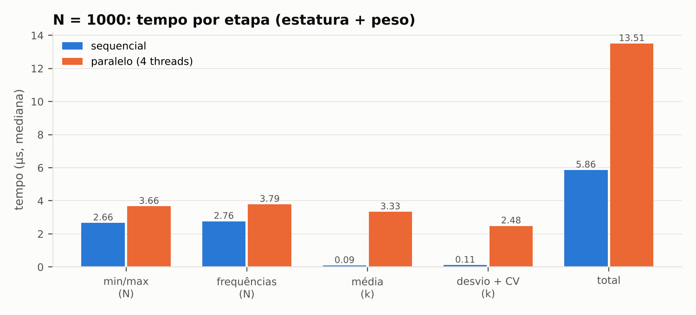
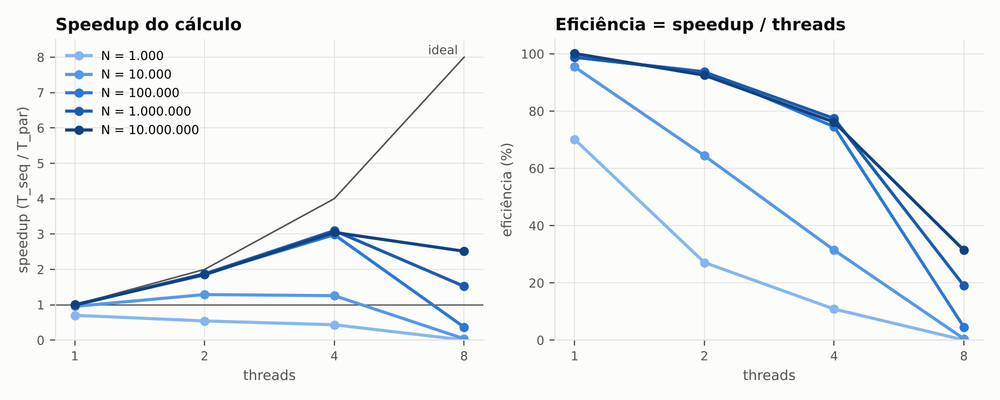

# 1. Objetivo

Implementar em C++ um programa que calcula o **coeficiente de variação (CV)** da
estatura (cm) e do peso (kg) de 1000 pessoas, com os dados **agrupados em classes**
(8 cm para estatura e 4 kg para peso), e paralelizar os laços de cálculo com
**OpenMP**. O mesmo programa executa a versão sequencial e a paralela sobre os mesmos dados,
confere se os resultados são iguais e mede o tempo das duas.

Código-fonte: `src/cv_openmp.cpp`. Como compilar e executar: Apêndice A.

# 2. Dados de entrada

O programa lê um arquivo de texto com uma pessoa por linha, estatura e peso separados
por espaço (ex.: `172.4 68.9`). O enunciado não trouxe o arquivo de dados, então foi
gerado um conjunto **sintético e reprodutível** de 1000 pessoas
(`dados/pessoas_1000.txt`, gerado por `scripts/gerar_dados.py` com semente 2025):

* estatura ~ Normal(170 cm; 9 cm), limitada a [140, 205] cm;
* IMC ~ Normal(25; 4) kg/m² e peso = IMC × (estatura em m)², o que deixa o peso
  correlacionado com a altura, como nos dados reais.

Qualquer outro arquivo no mesmo formato pode ser usado: basta passá-lo como argumento
(`./cv_openmp arquivo.txt`). O leitor ignora linhas de cabeçalho, aceita TAB/`;` como
separador e vírgula decimal, e converte a estatura para cm se ela vier em metros.

# 3. Agrupamento em classes e fórmulas

Para cada variável, com amplitude de classe $h$ (8 cm ou 4 kg):

* a primeira classe começa em $L_0 = \lfloor \text{menor valor} \rfloor$;
* a classe $i$ é o intervalo $[L_0 + i\,h,\; L_0 + (i+1)\,h)$, fechado à esquerda e aberto à direita;
* o número de classes é $k = \lfloor (\text{maior} - L_0)/h \rfloor + 1$, o que garante que o maior valor caia na última classe;
* o ponto médio da classe é $x_i = L_0 + (i + 0{,}5)\,h$ e $f_i$ é o número de pessoas nela.

Com a tabela de classes pronta, aplicam-se as fórmulas do enunciado:

$$\mu = \frac{\sum_{i=1}^{k} x_i\, f_i}{\sum_{i=1}^{k} f_i} = \frac{\sum_{i=1}^{k} x_i\, f_i}{N}
\qquad
\sigma = \sqrt{\frac{\sum_{i=1}^{k} f_i\,(x_i-\mu)^2}{N}}
\qquad
CV = \frac{\sigma}{\mu}\times 100\%$$

# 4. O que foi paralelizado e por quê

O cálculo de cada variável passa por quatro etapas. Duas percorrem as **N pessoas**; as
outras duas percorrem só as **k classes** (7 para estatura e 22 para peso):

| Etapa | Laço sobre | Diretiva OpenMP | Por que esta diretiva |
|---|---|---|---|
| 1. menor e maior valor | N pessoas | `parallel for reduction(min:mn) reduction(max:mx)` | cada thread acha o mín./máx. do seu bloco; o OpenMP compara os resultados no final |
| 2. frequências $f_i$ (histograma) | N pessoas | `parallel for reduction(+ : f[:k])` | cada thread conta num histograma **privado** de *k* posições; os histogramas são somados no final |
| 3. média: $\sum x_i f_i$ e $\sum f_i$ | k classes | `parallel for reduction(+ : sxf, sf)` | duas somas com o mesmo operador na mesma cláusula |
| 4. desvio padrão: $\sum f_i (x_i-\mu)^2$ | k classes | `parallel for reduction(+ : s)` | $\mu$ já é conhecido e é apenas lido pelas threads |

Trecho central (etapa 2, a mais importante):

```cpp
#pragma omp parallel for schedule(static) reduction(+ : f[:k])
for (long long i = 0; i < n; ++i) {
    f[classe_de(x[i], L0, h, k)]++;   // sem reduction: condição de corrida em f[c]
}
```

**Condições de corrida.** Todos os laços acumulam o resultado em variáveis compartilhadas
(somas, mínimo, máximo, contadores). Sem proteção, duas threads podem ler o mesmo valor
antigo e uma das atualizações se perde. No histograma, duas threads podem achar pessoas da
mesma classe e executar `f[c]++` ao mesmo tempo. A solução adotada em todos os laços é a
cláusula `reduction`: cada thread trabalha numa cópia privada, iniciada com o elemento
neutro (0 na soma, $+\infty$ no mínimo, $-\infty$ no máximo), e o OpenMP combina as cópias
uma única vez por thread no fim do laço. As alternativas foram descartadas:
`critical` em cada iteração serializa o laço, e `atomic` faz todas as threads disputarem as
mesmas posições de memória milhões de vezes. As duas ficariam mais lentas que o código
sequencial. Como cada thread tem o próprio histograma, também não há *false sharing* nos
contadores durante o laço.

**Escalonamento.** `schedule(static)`: toda iteração custa o mesmo, então blocos
contíguos de tamanho igual equilibram a carga sem custo extra de escalonamento (o
`dynamic` só se paga quando a carga é desigual).

**O que ficou sequencial, e por quê:**

* **Leitura do arquivo**: é E/S de disco seguida da conversão de texto em número. Ela é
  igual nas duas versões e fica fora da comparação, mas entra na análise de Amdahl (Seção 6.3).
* **Montagem das classes** ($L_0$, $k$, $x_i$): são $O(k)$ operações (k ≤ 22), um trabalho desprezível.
* **Média em duas passadas**: o desvio padrão depende de $\mu$, por isso a etapa 4 só
  começa depois da etapa 3. É uma dependência real entre etapas, não entre iterações.

**Validação.** A cada repetição, o programa compara a tabela de frequências e os valores de
$\mu$, $\sigma$ e CV das duas versões (tolerância relativa de $10^{-9}$ para as somas em ponto
flutuante, cuja ordem muda com as threads). As frequências são idênticas em todas as
execuções e o CV não mudou com 1, 2, 4 ou 8 threads (coluna `valido` = 1 em
`resultados/benchmark.csv`). Além disso, `scripts/verificar.py` recalcula tudo em Python,
de forma independente, e chega aos mesmos valores até a 4ª casa decimal.

# 5. Resultados


**Estatura** (h = 8 cm, k = 7 classes; menor valor 144,5 cm, maior 197,9 cm):

| Classe (cm) | $x_i$ | $f_i$ | $x_i f_i$ | $f_i (x_i-\mu)^2$ |
|---|--:|--:|--:|--:|
| 144 ⊢ 152 | 148 | 20 | 2 960 | 9 942,23 |
| 152 ⊢ 160 | 156 | 97 | 15 132 | 19 824,43 |
| 160 ⊢ 168 | 164 | 291 | 47 724 | 11 535,13 |
| 168 ⊢ 176 | 172 | 342 | 58 824 | 993,04 |
| 176 ⊢ 184 | 180 | 180 | 32 400 | 16 950,17 |
| 184 ⊢ 192 | 188 | 58 | 10 904 | 18 179,03 |
| 192 ⊢ 200 | 196 | 12 | 2 352 | 7 928,35 |
| **Total** | | **1000** | **170 296** | **85 352,38** |

**Peso** (h = 4 kg, k = 22 classes de 35 a 123 kg). A tabela completa está em
`resultados/saida_1000.txt`; os totais são $\sum f_i = 1000$, $\sum x_i f_i = 73\,056$ e
$\sum f_i (x_i-\mu)^2 = 195\,836{,}86$.

| Variável | Média $\mu$ | Desvio padrão $\sigma$ | **Coeficiente de variação** |
|---|--:|--:|--:|
| Estatura | 170,2960 cm | 9,2386 cm | **CV = 5,43 %** |
| Peso | 73,0560 kg | 13,9942 kg | **CV = 19,16 %** |

**Interpretação.** O CV permite comparar a dispersão de variáveis com unidades diferentes.
A estatura tem dispersão relativa **baixa** (CV ≤ 15 %): o grupo é homogêneo em altura. O
peso tem dispersão **média** (15 % < CV ≤ 30 %) e é cerca de 3,5 vezes mais variável que
a estatura em relação à própria média. Isso é esperado, porque o peso depende da altura
**e** da composição corporal (IMC).

**Efeito do agrupamento.** Calculado com os dados brutos (sem classes), o CV é 5,30 % para a
estatura e 19,15 % para o peso. A diferença é maior na estatura porque a classe de 8 cm é
larga em relação ao desvio (h/σ ≈ 0,9). No peso, h/σ ≈ 0,3. O agrupamento tende a
inflar a variância; a correção de Sheppard estima esse acréscimo em $h^2/12$.

# 6. Análise de desempenho

**Ambiente.** Intel Xeon @ 2,80 GHz com 4 vCPUs (1 thread por núcleo), 15 GB de RAM,
Ubuntu 24.04, g++ 13.3 (`-O2 -std=c++17 -fopenmp`), OpenMP 4.5.

**Protocolo de medição.** Tempos medidos com `omp_get_wtime()`. Cada execução faz uma
rodada de aquecimento, que é descartada (ela cria o *pool* de threads e carrega os dados na
cache), e depois *R* repetições em que as versões sequencial e paralela se **alternam**,
para que as duas sofram as mesmas condições da máquina. O valor reportado é a **mediana** das
*R* repetições (*R* = 2000 para N ≤ 10⁵, 200 para N = 10⁶ e 20 para N = 10⁷). O tempo cobre
as duas variáveis; a leitura do arquivo é medida à parte. Script: `scripts/benchmark.sh` →
`resultados/benchmark.csv`.

## 6.1 Com N = 1000 a versão paralela é mais lenta



O cálculo sequencial completo das duas variáveis leva **5,9 µs**. A versão paralela com 4
threads leva **13,5 µs** (*speedup* de 0,43×). O motivo é o **custo fixo de cada região
paralela**: acordar as threads, dividir o laço, esperar todas na barreira implícita do fim
e combinar as cópias da `reduction`. Isso custa da ordem de 1 a 2 µs por região, e o programa abre
8 regiões (4 etapas × 2 variáveis). Nos laços sobre as *k* classes (7 a 22 iterações),
o trabalho útil é de cerca de 0,1 µs e o custo fixo é dezenas de vezes maior. Nos laços sobre as
1000 pessoas, o trabalho (~1,3 µs por variável) também não é suficiente para pagar esse
custo. Mesmo com **1 thread** a versão OpenMP fica em 0,70×, o que mostra o custo da
infraestrutura sem nenhum paralelismo.

*Conclusão prática:* para 1000 pessoas a versão sequencial é a melhor escolha. Em um código de
produção, os laços sobre as classes ficariam sequenciais, ou com a cláusula
`if(k > limite)`. Eles foram paralelizados aqui porque o enunciado pede, e as medições
mostram o resultado.

## 6.2 Escalabilidade: aumentando N

Para ver a partir de que tamanho o paralelismo compensa, o mesmo programa foi executado
com arquivos maiores, gerados pelo mesmo modelo (10⁴ a 10⁷ pessoas):



| N | $T_{seq}$ (µs) | $T_{par}$ 4 thr. (µs) | 1 thread | 2 threads | 4 threads | 8 threads |
|--:|--:|--:|--:|--:|--:|--:|
| 1 000 | 5,9 | 13,5 | 0,70× | 0,54× | 0,43× | 0,004× |
| 10 000 | 53 | 42 | 0,95× | 1,29× | 1,26× | 0,04× |
| 100 000 | 544 | 182 | 0,99× | 1,88× | 2,98× | 0,37× |
| 1 000 000 | 5 606 | 1 810 | 0,99× | 1,87× | **3,10×** | 1,52× |
| 10 000 000 | 63 705 | 20 920 | 1,00× | 1,85× | 3,05× | 2,51× |

* **Ponto de equilíbrio**: o paralelismo começa a compensar por volta de N = 10⁴. A
  partir de N = 10⁵, o *speedup* chega a **≈ 3× com 4 threads**, com eficiência de 75 % a 77 %,
  e com 2 threads a eficiência fica em torno de 93 %.
* **Por que não chega a 4×?** Dentro do cálculo, a parte sequencial é desprezível (a montagem
  das classes e os laços sobre *k* somam cerca de 2 µs em 64 ms), então a Lei de Amdahl prevê
  quase 4×. A distância até o ideal vem de: (i) o custo de criação e sincronização das threads
  e da combinação das reduções; (ii) a **banda de memória**: com N = 10⁷, cada vetor tem 80 MB,
  mais que a L3 de 33 MB, então os dados vêm da RAM, que é compartilhada pelos núcleos; (iii) os
  núcleos são **vCPUs virtualizados**, cujo desempenho por núcleo cai quando todos estão
  ocupados. Por etapa, com N = 10⁷: min/máx escala 3,6× e frequências escala 2,8×, porque o
  histograma também escreve em memória e precisa combinar os contadores no final.
* **8 threads em 4 processadores (sobreassinatura)**: há mais threads que núcleos, então o
  sistema operacional precisa revezá-las. Cada barreira passa a esperar uma thread que está
  fora da CPU, e o custo de cada região paralela salta de ~1–2 µs para ~180 µs. Isso destrói o
  ganho para N pequeno e reduz o ganho para N grande (2,5× contra 3,05× com 4 threads). O número
  de threads não deve passar do número de núcleos.

## 6.3 Programa inteiro e Lei de Amdahl

Quando a **leitura do arquivo** (sequencial) entra na conta, o quadro muda. Ler e converter o
texto custa cerca de 200 ns por pessoa, enquanto o cálculo custa cerca de 6 ns. A leitura
representa **≈ 97 % do tempo total**:

| N | Leitura | Cálculo seq. | Cálculo par. (4 thr.) | Fração paralelizável *f* | Amdahl, *S*(4) | *Speedup* medido do programa |
|--:|--:|--:|--:|--:|--:|--:|
| 1 000 | 0,21 ms | 0,006 ms | 0,014 ms | 2,8 % | 1,02× | 0,97× |
| 10 000 000 | 2 022 ms | 63,7 ms | 20,9 ms | 3,1 % | 1,02× | 1,02× |

Pela Lei de Amdahl, $S(p) = 1/\left[(1-f) + f/p\right]$. Com *f* ≈ 3 %, nem infinitas
threads levariam o programa inteiro além de $1/(1-f) \approx 1{,}03\times$. O cálculo ficou 3×
mais rápido, mas o programa como um todo praticamente não acelera. O próximo passo para
ganhar tempo real seria **paralelizar a leitura**: dividir o arquivo em blocos que terminam
em quebra de linha e converter cada bloco em uma thread. Esse é o gargalo que a análise
revelou.

# 7. Conclusão

O programa calcula corretamente o coeficiente de variação para dados agrupados:
**CV da estatura = 5,43 %** (dispersão baixa) e **CV do peso = 19,16 %** (dispersão
média). As versões sequencial e paralela produzem exatamente a mesma tabela de frequências
e os mesmos resultados com qualquer número de threads. As condições de corrida foram
tratadas com `reduction` (escalar, `min`/`max` e sobre vetor), que é mais eficiente que
`critical` ou `atomic` para acumulações.

Do ponto de vista de desempenho, o resultado mais importante é que **com 1000 pessoas o
paralelismo não compensa**: o custo fixo do OpenMP (≈ µs por região) supera o trabalho
(≈ 6 µs no total). O ganho aparece a partir de ~10⁴ pessoas e chega a ≈ 3× com 4 threads em
entradas grandes. Mesmo assim, o tempo do programa inteiro é dominado pela leitura do arquivo,
que é sequencial e, pela Lei de Amdahl, limita o *speedup* global a ≈ 1,03×.

# Apêndice A — Como compilar e executar

```bash
make                                   # compila: g++ -O2 -std=c++17 -fopenmp ...
./cv_openmp dados/pessoas_1000.txt 4   # arquivo, threads [, repetições]
make verificar                         # conferência independente em Python
make benchmark                         # gera resultados/benchmark.csv
make graficos                          # gera resultados/graficos/*.png
```

No Windows (MinGW/PowerShell): `g++ -O2 -std=c++17 -fopenmp src\cv_openmp.cpp -o cv_openmp.exe`
e `.\cv_openmp.exe dados\pessoas_1000.txt 4`.
